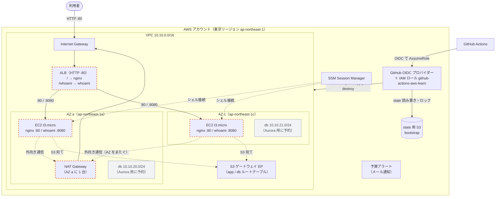
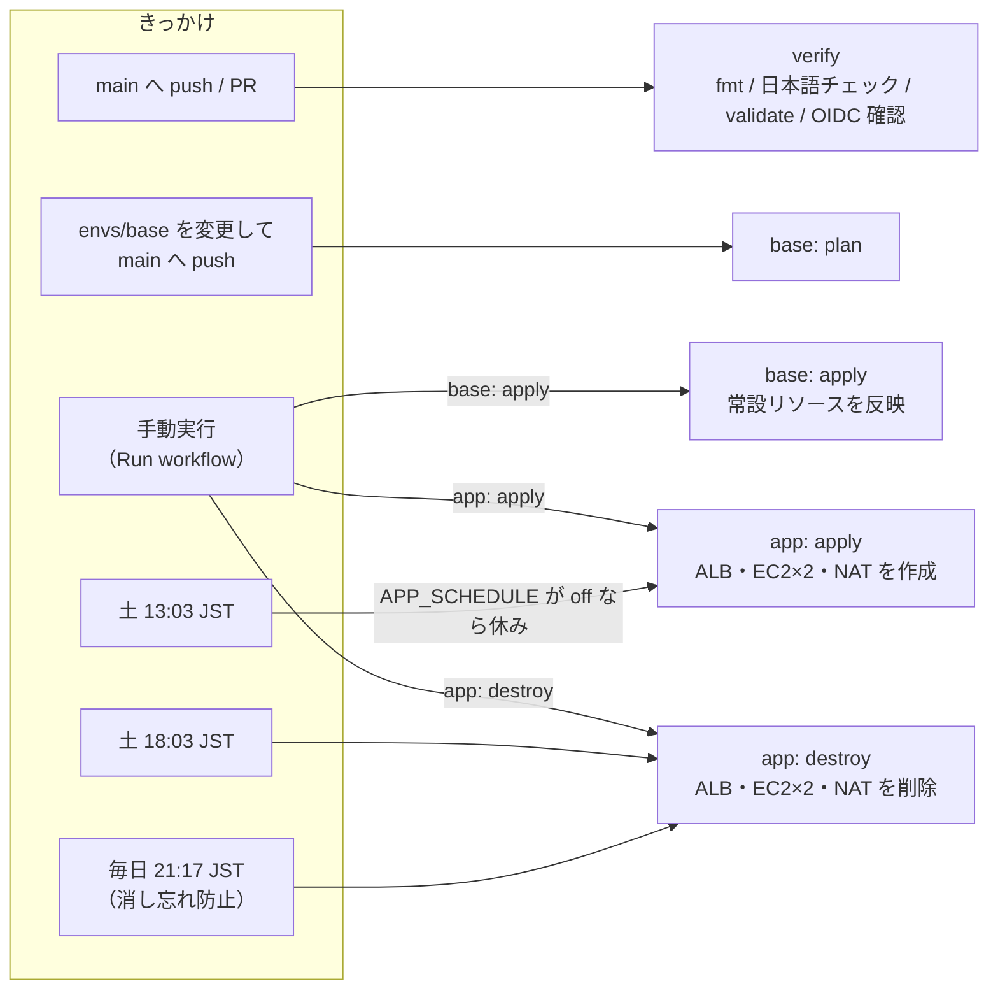

# aws-learn

Terraform + GitHub Actions の練習用 AWS 環境。

## 構成図

実線の枠は常設（envs/base・bootstrap）、点線の枠は都度作成（envs/app）。



- ALB は public サブネット（AZ a・c）に、EC2 は app サブネット（a: 10.10.10.0/24、c: 10.10.11.0/24）に置く
- NAT Gateway は費用を抑えるため 1 台だけ。app ルートテーブルは 2AZ 共通なので、AZ c の EC2 も AZ a の NAT を通る
- EC2 への接続は SSM Session Manager のみ（SSH ポートは開けない）

### GitHub Actions の流れ



## ディレクトリ構成

```
aws-learn/
├── bootstrap/              # 最初に1回だけ CloudShell から apply する土台（GitHub Actions からは変更不可）
│   └── main.tf             # state 用 S3、GitHub OIDC、GitHub Actions 用 IAM ロール
├── envs/
│   └── base/               # 常設（料金がかからないもの）。GitHub Actions の base ワークフローで apply
│       ├── network.tf      # VPC、サブネット（public / app / db × 2AZ）、IGW、ルートテーブル、S3 ゲートウェイ EP
│       ├── security_groups.tf  # ALB / app / db の SG
│       ├── iam.tf          # EC2 用ロール（SSM Session Manager）
│       └── budget.tf       # 予算アラート
│   └── app/                # 都度作成（料金がかかるもの）。app ワークフローで起動・削除
│       ├── nat.tf          # NAT Gateway、app ルートテーブルへの経路
│       ├── alb.tf          # ALB、パスベースルーティング（/ → nginx、/whoami → whoami）
│       ├── ec2.tf          # EC2 × 2（AZ ごと、SSM 接続、IMDSv2）
│       └── user_data.sh    # nginx と traefik/whoami（Docker）の初期設定
├── scripts/
│   └── check_aws_strings.py  # resource 内の日本語チェック
└── .github/workflows/
    ├── verify.yml          # fmt / 日本語チェック / validate / OIDC 確認
    ├── base.yml            # envs/base の plan（push 時）と apply（手動実行時）
    └── app.yml             # envs/app の起動（土 13:03）・削除（土 18:03、毎日 21:17）・手動実行
```

## 運用

- 定期：土曜 13:03 JST に起動、18:03 JST に削除。消し忘れ防止に毎日 21:17 JST にも削除
- 臨時：Actions > app > Run workflow で apply / destroy
- 定期起動を休む：リポジトリの変数 `APP_SCHEDULE` を `off`（削除は止まらない）
- 時間の変更：`app.yml` の cron と START_CRON / STOP_CRON を書き換える（ファイル先頭に JST と UTC の対応表あり）
- 費用の目安：起動中 1 時間あたり約 0.13 USD（NAT Gateway 約 0.067、ALB 約 0.034、EC2 t3.micro × 2 約 0.027）

## ネットワーク設計

| 用途 | AZ a | AZ c | 外への経路 |
| --- | --- | --- | --- |
| public（ALB、NAT） | 10.10.0.0/24 | 10.10.1.0/24 | Internet Gateway |
| app（EC2） | 10.10.10.0/24 | 10.10.11.0/24 | NAT Gateway（envs/app が経路を追加）、S3 はゲートウェイ EP |
| db（Aurora 用に予約） | 10.10.20.0/24 | 10.10.21.0/24 | なし（S3 はゲートウェイ EP） |

通信の許可：インターネット →(80) ALB →(80, 8080) EC2 →(3306) DB

## bootstrap の設計メモ

- state 用 S3：バージョニング・暗号化・パブリックアクセスブロック・HTTPS 強制。`prevent_destroy` で誤削除を防止
- ロック：S3 ネイティブロック（`use_lockfile = true`）。DynamoDB テーブルは作らない
- GitHub Actions 用ロール
  - 信頼ポリシーで「このリポジトリの main ブランチ」からの実行だけを許可。OIDC の sub は 2026-07-15 以降の新形式（`repo:オーナー@ID/リポジトリ@ID:...`）に合わせ、数値 ID まで一致させている
  - 権限は `PowerUserAccess`（IAM 以外ほぼ全部）＋「`aws-learn-` で始まるロール・インスタンスプロファイルだけ」を作れるインラインポリシー
  - ロール自身の名前は `github-actions-aws-learn` とし、上の接頭辞に当てはまらないため自分の権限を書き換えられない

## 初回セットアップ（CloudShell）

```bash
cd ~/aws-learn/bootstrap
export TF_DATA_DIR=/tmp/tfdata-bootstrap   # プロバイダー（数百MB）をホーム外に置く
cp terraform.tfvars.example terraform.tfvars   # 値を書き換える
terraform init
terraform validate
terraform plan
terraform apply
```

その後 `backend.tf.example` を `backend.tf` にリネームしてバケット名を書き換え、`terraform init -migrate-state`。
